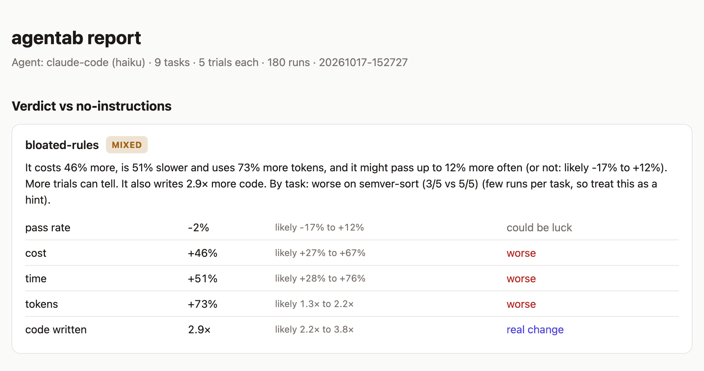
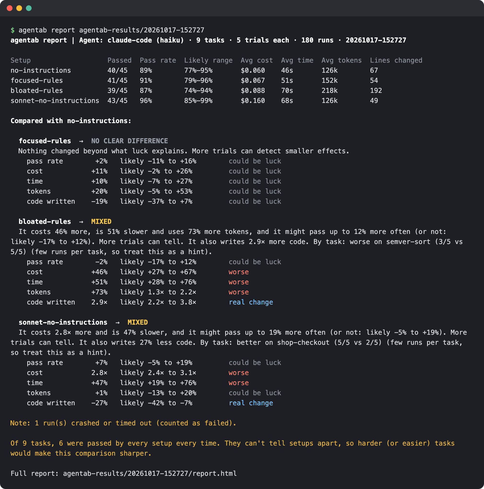
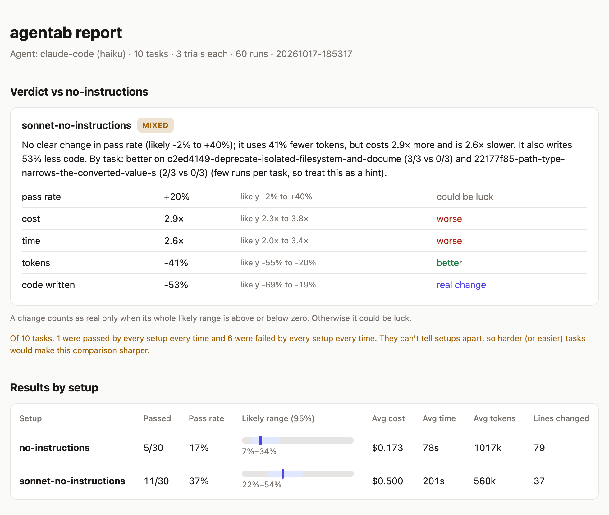

# agentab

[](LICENSE)
[](pyproject.toml)
[](#quickstart)

**A/B test your coding agent's setup.** Find out whether your CLAUDE.md, skills or model
choice actually make your agent better, or just more expensive, on real tasks from your own
repository's history, graded by tests.

> In our test, a long "best practices" CLAUDE.md made Claude (Haiku) **46% more expensive**
> and **51% slower**, with **no gain in tests passed** (39/45 vs 40/45 without it).



<sub>Real result: Claude Code (Haiku), 9 tasks × 5 runs = 45 runs per setup, no CLAUDE.md vs
[a 51-line "best practices" CLAUDE.md](examples/setups/bloated-rules/CLAUDE.md). The verdict
is MIXED rather than WORSE because, with 45 runs, a small pass-rate gain can't be ruled out
yet. See [Findings](#findings).</sub>

## Quickstart

Requires Python 3.11+, git, and macOS or Linux.

```bash
# 1. Install
git clone https://github.com/vamsisuhas/agentab && cd agentab
python3 -m venv .venv && source .venv/bin/activate && pip install -e .

# 2. Turn your repo's git history into tasks that are graded by tests
agentab mine path/to/your/repo --limit 20

# 3. Compare setups (the first one is the baseline)
agentab run --tasks agentab-tasks/your-repo --setups setups/baseline setups/new-rules --trials 3
```

`mine` keeps only past commits whose tests fail before the change and pass after it, so
every task is real and solvable. `run` uses Claude Code by default, with the login you
already have (any other CLI agent works with `--agent cmd:'...'`). You get a verdict for
every setup in the terminal, plus a shareable `report.html`.

**Try it first without any AI** (free and instant). The built-in mock agent fakes the
results, so you can see what the output looks like:

```bash
agentab run --agent mock --trials 10 --tasks examples/tasks \
  --setups examples/setups/no-instructions examples/setups/focused-rules
```

**What's a setup?** A folder of files dropped into the project before the agent starts:

```
setups/
  baseline/                  # can be empty
  new-rules/CLAUDE.md
  with-skill/.claude/skills/my-skill/SKILL.md
```

## Why

Everyone tunes their agent: a longer CLAUDE.md, a new skill pack, another MCP server, a
different model. Almost nobody measures whether it helped.

Measuring is harder than it looks, because **agents are random**. The same task can pass
once and fail the next time, so trying a change once tells you nothing. agentab runs each
task several times per setup, grades every run with tests, and tells you which differences
are real and which could just be luck.



## Findings

Real runs with Claude Code, measured with agentab. These are small experiments, so read
the ranges, not just the headline numbers. "Likely" means a 95% range.

**1. A long "best practices" CLAUDE.md cost more and didn't help.**
Haiku, 9 small Python tasks, 45 runs per setup, compared with no CLAUDE.md at all:

| | No CLAUDE.md | Long CLAUDE.md | Change (likely range) |
|---|---|---|---|
| Tests passed | 40/45 | 39/45 | -2% (-17% to +12%), could be luck |
| Avg cost per task | $0.060 | $0.088 | **+46%** (+27% to +67%) |
| Avg time per task | 46s | 70s | **+51%** (+28% to +76%) |
| Avg tokens | 126k | 218k | **+73%** (1.3× to 2.2×) |
| Lines of code changed | 67 | 192 | **2.9×** (2.2× to 3.8×) |

A short, focused CLAUDE.md in the same run showed no clear difference on anything.

On a second, partly finished run (26 tasks mined from click, express and chi, 39 to 50
runs per setup, where every setup passed 92% to 97%), the same long CLAUDE.md showed **no
clear difference** in cost, time or tokens, only more code (+35%, likely +1% to +77%). So
the cost penalty depends on the tasks. That's the point: test on your own repo.

**2. Sonnet vs Haiku on hard tasks: probably better, definitely pricier.**
10 harder tasks mined from [click](https://github.com/pallets/click)'s history, with the
tests hidden from the agent, 30 runs per model:



- Pass rate: Haiku **17%** (5/30) vs Sonnet **37%** (11/30). The difference is +20%, but
  the likely range is -2% to +40%, so even this big gap isn't proven with 30 runs.
- Sonnet cost **2.9×** as much (likely 2.3× to 3.8×) and took **2.6×** as long.
- Sonnet used 41% fewer tokens and wrote 53% less code.

On 9 easier tasks (45 runs each) Haiku already passed 89% and Sonnet 96%, a difference
agentab called "could be luck", at 2.8× the cost.

**The lesson: pass-rate differences need many runs.** Cost, time and token differences
showed up clearly with 30 to 45 runs per setup. Pass-rate differences of 10 to 20% did
not, and can take 100 or more runs per setup to prove. That's exactly why trying a change
once or twice tells you nothing.

You can open a full real report (all three setups vs the baseline, every run with its test
output) by downloading [`docs/example-report.html`](docs/example-report.html) and opening
it in a browser.

## How a run works

For every setup × task × trial, agentab:

1. Builds a fresh workspace: the task's starting code, the setup's files, and the task's
   tests (so the agent can read and run them). The original repository's `.git` is never
   included, since it contains the answer.
2. Runs the agent on the task prompt.
3. Saves what the agent changed as a patch.
4. Puts back the original tests and test configuration (`conftest.py`, `pytest.ini`,
   `jest.config.*`, files in test folders...), so the agent can't pass by editing or
   skipping tests, then runs them. Pass or fail.

agentab never calls an AI API itself. It runs the agent's own CLI, so it uses whatever
login or API key that agent already has.

## Mining tasks: `agentab mine`

```bash
agentab mine .                                  # the repo you're in
agentab mine https://github.com/pallets/click   # or a URL (cloned into ~/.cache/agentab)
```

For each candidate commit, agentab checks that:

- **before**: the code just before the commit plus the commit's tests **fails**, and
- **after**: the same, plus the commit's code changes, **passes** (twice, to catch flaky tests).

Only commits passing both checks become tasks, so every task is a real, solvable change with
tests proving it. Commits are skipped (and counted, with the reason) when they don't change
tests, only change tests, delete or rename tests, are too big, or their tests already pass,
time out or can't run. Everything is written to `mine-report.json`.

**Supported out of the box** (detected automatically):

| Ecosystem | Test files | Tests run with |
|---|---|---|
| Python | `test_*.py`, `*_test.py`, `tests/` | `pytest` |
| JavaScript / TypeScript | `*.test.*`, `*.spec.*`, `__tests__/`, `test/` | jest, vitest, mocha or `npm test` |
| Go | `*_test.go` | `go test` |
| Ruby | `*_spec.rb`, `*_test.rb` | RSpec or Minitest |
| Rust | `tests/*.rs` | `cargo test` |
| Java / Kotlin | `src/test/**/*Test.java` | Maven or Gradle |

Anything else works with `--test-command '<command with {files}>'` and
`--test-pattern 'glob'`.

**Dependencies.** Tasks run against the dependencies you already have installed, the same
way your tests normally run:

- **Python**: the repo's `.venv` is used automatically (or pass `--python`). The workspace
  always comes first on the import path, so an editable install (`pip install -e .`) can't
  make tests import the original code by mistake.
- **JavaScript**: `node_modules` folders are linked in automatically. Run `npm install` in
  the repo first, or use `--setup 'npm ci'`.
- **Ruby**: the project's current `Gemfile` is used, so old commits don't need old gems.
- **Anything else**: `--setup '<command>'` runs in every workspace before the agent starts,
  `--link <folder>` links a folder in instead of copying it, and `--env KEY=VALUE` sets
  environment variables.

**Prompt styles.**

- `--style tests` (default): the agent gets the commit message and the list of failing
  tests, and can read and run them. Every task is clearly specified.
- `--style message`: the tests stay hidden and the commit message is the whole task (add
  `--github` to include linked GitHub issues). Harder and closer to real life, but only
  fair for commits with good descriptions, so short messages are skipped.

Other useful options: `--limit`, `--max-commits`, `--since 2025-01-01`, `--rev v2.0..main`,
`--path src/parser` and `--snapshot` (copy the code into each task so the task folder is
self-contained and shareable). Run `agentab mine --help` for all of them.

## Writing tasks by hand

```
my-task/
  task.toml    # the prompt and the test command
  repo/        # the starting code
  checks/      # tests, copied in after the agent finishes (overwriting any edits)
  solution/    # optional: the correct files (used by the mock agent)
```

```toml
prompt = "average([]) crashes with ZeroDivisionError. It should return 0.0."
test = "{python} -m unittest -q test_hidden"   # exit code 0 = pass
timeout = 300

[workspace]               # all optional
show_checks = false       # true: copy checks/ in before the agent too
setup = "npm ci"          # runs before the agent, not counted in its time
agent_commands = ["python -m pytest"]   # commands the agent may run
env = { RAILS_ENV = "test" }
```

Instead of `repo/`, a task can start from a commit: `[source]` with `git = "<path or URL>"`
and `rev = "<commit>"`. This is what `agentab mine` writes.

## Setups and models

A setup can pick its own model in an optional `.agentab.toml` (never copied into the
workspace), so you can test "is the bigger model worth it?":

```toml
[agent]
model = "sonnet"
```

## Agents

| `--agent` | What it runs | Cost data |
|---|---|---|
| `claude-code` | `claude -p` (add `--model haiku` / `sonnet` / `opus`) | yes |
| `cmd:'<command>'` | any CLI agent, e.g. `cmd:'codex exec --full-auto {prompt}'` | pass/fail and time only |
| `mock` | a fake agent for demos and tests | simulated |

Claude Code runs with file edits allowed, and shell access limited to the task's test
command (turn that off with `--no-agent-test-runs`). Your personal `~/.claude` settings are
ignored so every setup starts equal.

## Reading the results

[Here is what a full report looks like](docs/report-full.png) (or download
[`docs/example-report.html`](docs/example-report.html) and open it in a browser).

- **Pass rate**: how many runs passed the tests, with a 95% "likely range".
- **Every metric gets checked**: pass rate, cost, time, tokens and lines of code changed.
  A change counts as real only when its whole likely range is above or below zero:
  Newcombe's method for pass rates, a per-task bootstrap for the rest, with a Bonferroni
  correction because several metrics are checked at once.
- **Verdict**: pass rate decides first. If it didn't really change, efficiency decides:
  same results for more money or time is **WORSE**, for less is **BETTER**, a bit of both
  is **MIXED**, and **NO CLEAR DIFFERENCE** means nothing moved beyond luck. "Same
  results" has to be shown, not assumed: a setup that costs more is only called WORSE once
  a pass-rate gain of more than 10% has been ruled out (and a cheaper one only BETTER once
  a drop of more than 10% has). Until then it's **MIXED**, and more trials can tell.
- **By task**: large differences on single tasks are pointed out (Fisher's exact test says
  whether they're real or just a hint), along with tasks that every setup always passes or
  always fails, since those can't tell setups apart.

## Long runs

- Runs that fail for reasons that aren't the setup's fault (API errors, rate limits, a
  failed setup command) are **retried, then left out of the statistics**, never counted
  as failures.
- After 5 errors in a row (for example, a usage limit) agentab stops instead of burning
  through the rest.
- Every finished run is saved immediately, and Ctrl-C stops everything cleanly. Continue
  an interrupted run, retry its errors, or add more trials with `--resume` (it refuses
  to mix in runs from a different agent or model):

```bash
agentab run --resume agentab-results/20261017-152727 --tasks ... --setups ... --trials 5
```

## Roadmap

- [ ] GitHub Action: comment on PRs that change `CLAUDE.md` or skills
- [ ] Built-in adapters for Codex, OpenCode, Gemini CLI and Cursor with cost data
- [ ] Docker workspaces for projects with complex dependencies
- [ ] Paired statistics across tasks for more power with fewer runs

## License

MIT
